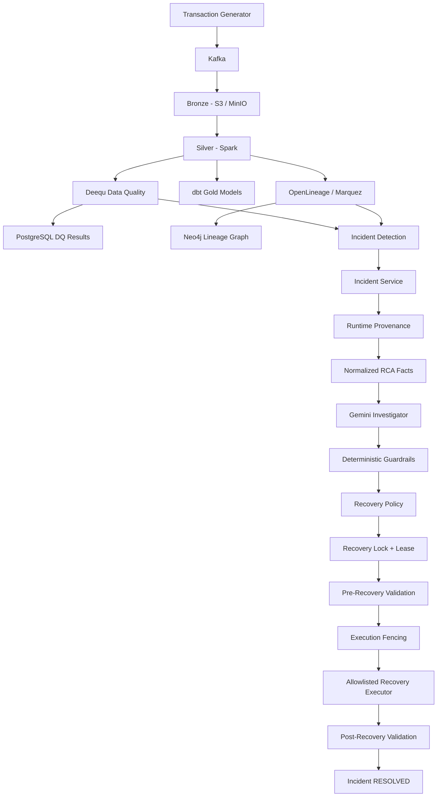

# AI-Powered Data Pipeline Incident Detection & Recovery Platform

A production-style data engineering platform that detects pipeline failures, creates incidents, performs lineage-aware root-cause analysis, and safely executes automated recovery using deterministic guardrails around AI-assisted investigation.

The system demonstrates a full path from data ingestion to autonomous incident response:

```text
Kafka
↓
Bronze
↓
Silver
↓
Data Quality
↓
Gold
↓
Lineage + Observability
↓
Incident Detection
↓
Root Cause Analysis
↓
Deterministic Recovery Policy
↓
Safe Automated Recovery
↓
Validation
↓
Incident Resolution
```

---

## Project Status

```text
Phase 1 — Core Data Pipeline                         COMPLETE
Phase 2 — Data Quality, Metadata, and Lineage        COMPLETE
Phase 3 — Incident Detection and Recovery            COMPLETE
Phase 3F — Production Hardening                      COMPLETE
```

Final hardened regression:

```text
Incident ID:        8
Incident Type:      SCHEMA_DRIFT
Recovery Attempt:   25
Recovery Status:    COMPLETED
Incident Status:    RESOLVED
Final Silver Schema: 15 columns
Active Workers:     0
```

---

# 1. Why This Project Exists

Modern data platforms often detect failures but still depend on engineers to manually:

- identify the affected dataset
- inspect lineage
- determine root cause
- decide whether recovery is safe
- run remediation commands
- verify whether the repair worked
- close the incident

This project explores how much of that workflow can be automated safely.

The design intentionally separates:

```text
AI reasoning
```

from:

```text
infrastructure authority
```

AI assists investigation.

Deterministic controls decide whether recovery is allowed.

---

# 2. Core Design Principle

The platform follows one central rule:

> AI may assist with investigation, but deterministic controls decide whether infrastructure-changing recovery is permitted.

The authority chain is:

```text
Observed Evidence
↓
Runtime Provenance
↓
Lineage Context
↓
Normalized RCA Facts
↓
AI Investigation
↓
Deterministic Guardrails
↓
Deterministic Recovery Policy
↓
Database Ownership
↓
Lease + Fencing
↓
Allowlisted Execution
↓
Post-Recovery Validation
```

The LLM never directly executes arbitrary infrastructure commands.

---

# 3. High-Level Architecture



---

# 4. Technology Stack

## Data Engineering

```text
Apache Kafka
Apache Spark
PySpark
MinIO / S3A
dbt
DuckDB
Apache Airflow
```

## Data Quality

```text
Amazon Deequ
Custom validation logic
PostgreSQL
```

## Lineage and Observability

```text
OpenLineage
Marquez
Neo4j
```

## Incident Platform

```text
Python
PostgreSQL
JSONB audit records
```

## AI-Assisted RCA

```text
Google Gemini
Provider-neutral AI contract
Deterministic RCA guardrails
```

Validated model:

```text
gemini-3.5-flash-lite
```

## Infrastructure

```text
Docker
Docker Compose
```

---

# 5. Phase 1 — Core Data Pipeline

Phase 1 establishes the ingestion and transformation foundation.

Flow:

```text
Python Transaction Generator
↓
Kafka Topic: transactions
↓
Bronze Storage
↓
Spark Processing
↓
Silver Transactions
```

Kafka topic:

```text
transactions
```

Partitions:

```text
3
```

Bronze storage:

```text
S3 / MinIO
```

Silver location:

```text
s3a://data-platform/silver/transactions
```

---

# 6. Silver Data Model

The healthy Silver dataset contains 15 columns:

```text
transaction_id
customer_id
order_id
payment_id
amount
payment_method
status
event_time
kafka_key
kafka_topic
kafka_partition
kafka_offset
kafka_timestamp
ingestion_timestamp
silver_processed_at
```

Known healthy Phase 3 baseline:

```text
55 rows
15 columns
```

Silver transformation job:

```text
spark/jobs/silver_transactions.py
```

---

# 7. Phase 2 — Data Quality

Phase 2 adds automated quality checks to the Silver layer.

Representative checks include:

```text
Null validation
Uniqueness validation
Positive-value checks
Schema validation
```

Deequ results are persisted into PostgreSQL:

```text
data_quality_results
```

This creates durable evidence that can later be converted into incidents.

---

# 8. Phase 2 — Gold Layer

dbt transforms validated Silver data into analytics-ready models.

Tools:

```text
dbt
DuckDB
```

The Phase 2 implementation includes staging and mart models with validated dbt tests.

---

# 9. Phase 2 — Lineage

Lineage is captured using:

```text
OpenLineage
Marquez
```

Neo4j is used for graph-based lineage analysis and blast-radius reasoning.

This enables questions such as:

```text
Which downstream assets depend on this dataset?
```

and:

```text
What systems are affected by this incident?
```

---

# 10. Phase 3 — Incident Service

The incident service persists detected failures in PostgreSQL.

Core table:

```text
incidents
```

Representative fields:

```text
incident_id
incident_type
dataset_name
source_system
severity
status
title
description
detected_at
resolved_at
metadata
```

Supported lifecycle:

```text
OPEN
↓
INVESTIGATING
↓
RECOVERING
↓
RESOLVED
```

---

# 11. Supported Incident Types

Phase 3 validates multiple incident categories:

```text
NULL_SPIKE
SCHEMA_DRIFT
SLA_BREACH
```

The primary automated-recovery scenario is:

```text
SCHEMA_DRIFT
```

---

# 12. Root Cause Analysis Architecture

RCA combines deterministic evidence with AI-assisted interpretation.

Core modules:

```text
incident_service/rca/facts.py
incident_service/rca/ai_contract.py
incident_service/rca/ai_investigator.py
incident_service/rca/diagnostics/runtime_provenance.py
incident_service/rca/providers/gemini.py
```

Flow:

```text
Incident
+
Lineage
+
Observed Schema
+
Runtime Provenance
↓
Normalized RCA Facts
↓
Gemini Investigator
↓
Deterministic Guardrails
```

---

# 13. Runtime Provenance

Controlled failure injections persist provenance evidence.

Typical evidence:

```text
execution_id
scenario
status
target_dataset
injected_column
injected_value
completed_at
```

Runtime provenance provides deterministic evidence of what changed.

This is especially important when validating AI-generated RCA.

---

# 14. AI Provider Contract

The RCA layer uses a provider-neutral interface.

This keeps orchestration logic independent of any specific LLM provider.

Current real provider:

```text
Google Gemini
```

The provider is responsible for structured investigation output.

The provider does not decide whether infrastructure recovery is authorized.

---

# 15. Deterministic RCA Guardrails

The AI response is checked against deterministic evidence.

For schema drift, a valid causal match may require:

```text
Injected Column
=
Observed Unexpected Column
=
Runtime Provenance Column
```

If AI output disagrees with deterministic evidence:

```text
deterministic evidence wins
```

---

# 16. Recovery Policy

Recovery policy:

```text
incident_service/recovery/policy.py
```

The policy maps normalized RCA facts to deterministic recovery actions.

Validated schema-drift action:

```text
RESTORE_SCHEMA_DRIFT_BACKUP
```

Automatic execution is permitted only when deterministic conditions are satisfied.

AI confidence alone cannot authorize recovery.

---

# 17. Recovery Executor

Recovery executor:

```text
incident_service/recovery/executor.py
```

The executor only supports allowlisted actions.

Schema-drift recovery flow:

```text
Clean Backup
↓
Temporary Restore
↓
Replace Drifted Silver
↓
Validate Restored Dataset
```

Backup path:

```text
s3a://data-platform/failure-backups/schema-drift/silver-transactions
```

Temporary restore path:

```text
s3a://data-platform/failure-temp/schema-drift-restore/silver-transactions
```

---

# 18. Recovery Validation

Validator:

```text
incident_service/recovery/validator.py
```

Schema capture job:

```text
spark/jobs/capture_silver_schema.py
```

Evidence:

```text
spark/evidence/silver_schema.json
```

Healthy validation contract:

```text
dataset_exists = True
capture_status = CAPTURED
healthy = True
recovery_needed = False
remaining_detections = []
schema_column_count = 15
```

An incident is not resolved until this contract passes.

---

# 19. Missing Dataset Handling

The validator explicitly differentiates:

```text
missing dataset
```

from:

```text
Spark / Docker / capture failure
```

Missing dataset:

```text
dataset_exists = False
capture_status = MISSING_DATASET
healthy = False
recovery_needed = True
```

Infrastructure validation failures raise a recovery validation error.

This prevents unknown states from being interpreted as healthy.

---

# 20. Recovery Audit Table

Recovery attempts are persisted in:

```text
recovery_attempts
```

Representative fields:

```text
recovery_attempt_id
incident_id
action
status
automatic_execution_allowed
rca_assessment
recovery_decision
execution_result
validation_result
error_message
started_at
completed_at
heartbeat_at
lease_expires_at
```

This provides a durable recovery audit trail.

---

# 21. Production Hardening

Phase 3F adds production-style protection around automated recovery.

Implemented controls include:

```text
Database-enforced concurrency
Lease-based ownership
Worker heartbeat
Expired-worker reclamation
Execution fencing
Per-command fencing
Replay protection
Structured failures
Bounded audit logs
Mandatory post-recovery validation
```

---

# 22. Concurrency Protection

Only one active recovery attempt may exist per incident.

PostgreSQL partial unique index:

```text
uq_recovery_attempts_active_incident
```

Active statuses:

```text
STARTED
RECOVERING
```

If a second worker attempts recovery:

```text
RECOVERY_ALREADY_IN_PROGRESS
```

The database is the final concurrency authority.

---

# 23. Lease and Heartbeat

Active recovery attempts contain:

```text
heartbeat_at
lease_expires_at
```

Default recovery lease:

```text
300 seconds
```

Heartbeat interval:

```text
60 seconds
```

If a worker crashes:

```text
heartbeat stops
↓
lease expires
↓
attempt becomes LEASE_EXPIRED
↓
another worker may reclaim the incident
```

---

# 24. Execution Fencing

Before destructive recovery begins:

```text
claim_recovery_execution()
```

atomically verifies that the worker still owns a valid lease.

The recovery attempt ID acts as the application-level fencing token.

A stale worker cannot continue destructive execution.

---

# 25. Per-Command Fencing

Ownership is refreshed before each external command.

Example:

```text
Guard
↓
Command 1
↓
Guard
↓
Command 2
```

If ownership is lost before Command 2:

```text
Command 2 does not execute
```

Failure type:

```text
EXECUTION_FENCE_REJECTED
```

This protects multi-command recovery workflows.

---

# 26. Replay Protection

Before execution, the validator checks whether the target still needs recovery.

If another worker already recovered the dataset:

```text
healthy = True
recovery_needed = False
```

the executor is skipped.

Audit status:

```text
ALREADY_RECOVERED
```

This makes recovery replay-safe after ambiguous worker crashes.

---

# 27. Structured Execution Failures

Executor failures are persisted as structured evidence.

Examples:

```text
COMMAND_FAILED
TIMEOUT
EXECUTION_GUARD_ERROR
EXECUTION_FENCE_REJECTED
```

Audit evidence includes:

```text
command
returncode
duration_ms
stdout_tail
stderr_tail
completed_steps
```

---

# 28. Bounded Audit Logs

Spark can produce large logs.

The recovery executor bounds captured output.

Success log limit:

```text
4000 characters
```

Failure log limit:

```text
2000 characters
```

Audit records preserve:

```text
original character count
truncation status
captured tail
```

This keeps PostgreSQL JSONB audit records manageable.

---

# 29. Failure Injection Framework

Controlled failure scenarios are stored under:

```text
failure_injection/scenarios/
```

Failure evidence:

```text
spark/evidence/failure_injections/
```

Validated scenarios include:

```text
Null spike
Schema drift
SLA breach
Concurrency conflict
RCA failure
Policy failure
Lease expiry
Stale worker
Structured executor failure
Replay / idempotency
Per-command fence rejection
```

---

# 30. Final Hardened Regression

The final Phase 3F test injected:

```text
final_hardening_test_column
```

with value:

```text
PHASE_3F_15
```

Observed drifted schema:

```text
16 columns
```

Detection:

```text
UNEXPECTED_COLUMN
```

Incident:

```text
Incident ID: 8
Type: SCHEMA_DRIFT
Severity: HIGH
Status: OPEN
```

---

# 31. Final Provenance Evidence

Execution ID:

```text
87533964-bd6a-4d8a-8253-a6c7da0b9fa5
```

Scenario:

```text
SCHEMA_DRIFT
```

Injected column:

```text
final_hardening_test_column
```

Injected value:

```text
PHASE_3F_15
```

Status:

```text
COMPLETED
```

---

# 32. Final Recovery Result

Real recovery:

```python
result = recover_incident(
    incident_id=8,
    provider=gemini_provider,
    dry_run=False,
)
```

Recovery attempt:

```text
25
```

Decision:

```text
RESTORE_SCHEMA_DRIFT_BACKUP
```

Execution:

```text
COMPLETED
```

Post-validation:

```text
dataset_exists = True
healthy = True
recovery_needed = False
remaining_detections = []
schema_column_count = 15
```

Final incident state:

```text
RESOLVED
```

Active workers:

```text
0
```

---

# 33. Recovery Safety Model

The automated-recovery design uses defense in depth.

```text
Runtime Provenance
+
Lineage
+
AI-Assisted RCA
+
Deterministic Guardrails
+
Deterministic Recovery Policy
+
Database Concurrency
+
Lease / Heartbeat
+
Execution Fencing
+
Per-Command Fencing
+
Replay Protection
+
Allowlisted Commands
+
Mandatory Validation
+
Durable Audit Trail
```

No single safety layer is treated as sufficient.

---

# 34. Repository Structure

Representative project structure:

```text
.
├── incident_service/
│   ├── db.py
│   ├── repository.py
│   ├── rca/
│   │   ├── facts.py
│   │   ├── ai_contract.py
│   │   ├── ai_investigator.py
│   │   ├── diagnostics/
│   │   │   └── runtime_provenance.py
│   │   └── providers/
│   │       └── gemini.py
│   └── recovery/
│       ├── executor.py
│       ├── orchestrator.py
│       ├── policy.py
│       ├── validator.py
│       └── sql/
├── spark/
│   ├── jobs/
│   │   ├── silver_transactions.py
│   │   └── capture_silver_schema.py
│   └── evidence/
├── failure_injection/
│   └── scenarios/
├── docs/
├── docker-compose.yml
└── README.md
```

---

# 35. Phase 3 Documentation

Detailed Phase 3 documentation is available in:

```text
docs/phase_3_incident_recovery.md
```

End-to-end incident detection, RCA, recovery, validation, and project status.

```text
docs/recovery_architecture.md
```

Recovery ownership, lease, fencing, replay protection, and architecture.

```text
docs/production_hardening.md
```

Detailed Phase 3F production-hardening implementation and test evidence.

```text
docs/failure_injection_testing.md
```

Controlled failure scenarios and regression proof.

```text
docs/troubleshooting.md
```

Real implementation issues, diagnostics, fixes, and operational guidance.

---

# 36. Local Environment

Development environment:

```text
macOS
Apple Silicon
Python 3.14.3
Docker 29.7.2
Docker Compose 5.4.0
Spark 3.5.1
PostgreSQL 16
```

---

# 37. Start the Platform

Start Docker Desktop.

Then:

```bash
docker compose start
```

Check:

```bash
docker compose ps
```

If services have not yet been created:

```bash
docker compose up -d
```

---

# 38. Stop the Platform

Use:

```bash
docker compose stop
```

Avoid destructive commands such as:

```bash
docker compose down -v
docker system prune
```

unless intentionally resetting persistent data.

---

# 39. Python Environment

Activate:

```bash
source .venv/bin/activate
```

Check:

```bash
python --version
```

---

# 40. Spark S3A Packages

Validated package combination:

```text
org.apache.hadoop:hadoop-aws:3.3.4
com.amazonaws:aws-java-sdk-bundle:1.12.262
```

Common Spark configuration:

```text
--conf spark.driver.extraJavaOptions="-Divy.cache.dir=/tmp/.ivy2"
--conf spark.jars.ivy=/tmp/.ivy2
```

---

# 41. Deequ Packages

Validated Deequ configuration:

```text
org.apache.hadoop:hadoop-aws:3.3.4
com.amazon.deequ:deequ:3.0.3-spark-3.5
org.postgresql:postgresql:42.7.4
```

Excluded dependency:

```text
net.sourceforge.f2j:arpack_combined_all
```

---

# 42. MinIO Endpoint

Inside Docker containers:

```text
http://minio:9000
```

---

# 43. PostgreSQL Incident Database

Container:

```text
incident-postgres
```

Database:

```text
ecommerce
```

User:

```text
dataengineer
```

Port:

```text
5432
```

---

# 44. Quick Incident Query

```sql
SELECT
    incident_id,
    incident_type,
    dataset_name,
    severity,
    status,
    detected_at,
    resolved_at
FROM incidents
ORDER BY incident_id;
```

---

# 45. Quick Recovery Audit Query

```sql
SELECT
    recovery_attempt_id,
    incident_id,
    action,
    status,
    started_at,
    completed_at,
    heartbeat_at,
    lease_expires_at
FROM recovery_attempts
ORDER BY recovery_attempt_id;
```

---

# 46. Active Recovery Worker Check

```sql
SELECT *
FROM recovery_attempts
WHERE status IN ('STARTED', 'RECOVERING');
```

Healthy final system state:

```text
0 rows
```

---

# 47. Project Integrity Checks

Check main project text files:

```bash
find incident_service spark failure_injection docs   -type f   \( -name '*.py' -o -name '*.md' -o -name '*.json'      -o -name '*.yaml' -o -name '*.yml' -o -name '*.sql'      -o -name '*.toml' -o -name '*.sh' -o -name '*.txt' \)   -exec file {} \;   | grep ': data$'
```

Expected:

```text
no output
```

Compile Python:

```bash
python -m compileall -q   incident_service   spark   failure_injection
```

Expected:

```text
no output
```

---

# 48. Known Design Tradeoff

The current schema restore uses:

```text
write temporary restore
↓
delete current Silver
↓
rename temporary restore
```

This is repeatable and convergent, but it is not a fully atomic distributed filesystem transaction.

A crash between delete and rename can temporarily leave the Silver path missing.

The platform mitigates this through:

```text
backup storage
pre-execution validation
replay protection
lease-based ownership
repeatable recovery
post-recovery validation
```

---

# 49. Future Enhancements

Potential future work includes:

```text
External fencing-token enforcement at the storage / execution layer
Multi-dataset automated recovery
More recovery action types
Automated pull-request remediation
Expanded Neo4j blast-radius analysis
Additional AI providers
Streaming incident detection
Recovery SLO dashboards
Chaos testing
Kubernetes deployment
Cloud-native AWS / GCP deployment
```

---

# 50. What This Project Demonstrates

This project demonstrates practical experience with:

```text
Data ingestion
Streaming systems
Spark processing
Data quality
dbt transformations
Data lineage
Metadata systems
Graph-based dependency analysis
Incident management
AI-assisted root-cause analysis
Deterministic safety controls
Automated recovery
Distributed concurrency
Leases and heartbeats
Fencing
Replay protection
Auditability
Failure injection
Production hardening
```

---

# 51. Final Status

```text
CORE DATA PIPELINE                  COMPLETE
DATA QUALITY                        COMPLETE
GOLD TRANSFORMATIONS                COMPLETE
LINEAGE / OBSERVABILITY             COMPLETE
INCIDENT DETECTION                  COMPLETE
LINEAGE-AWARE RCA                   COMPLETE
GEMINI RCA PROVIDER                 COMPLETE
DETERMINISTIC GUARDRAILS            COMPLETE
AUTOMATED RECOVERY                  COMPLETE
RECOVERY VALIDATION                 COMPLETE
CONCURRENCY HARDENING               COMPLETE
LEASE / HEARTBEAT                   COMPLETE
EXECUTION FENCING                   COMPLETE
PER-COMMAND FENCING                 COMPLETE
REPLAY PROTECTION                   COMPLETE
STRUCTURED AUDITING                 COMPLETE
FAILURE INJECTION                   COMPLETE
FULL REAL END-TO-END RECOVERY       COMPLETE
```

**PHASE 3 — COMPLETE**

---

# 52. Phase 4 — Platformization & Autonomous Operations

Phase 4 converts the hardened Phase 3 recovery engine into an autonomous operational platform.

Phase 4A adds an autonomous incident worker around the existing Phase 3 recovery orchestrator.

Candidate selection requires:

- status = OPEN
- automation_eligible = true
- no previous recovery_attempt

This provides at-most-once autonomous dispatch in Phase 4A. Retry, backoff, and requeue are deferred to Phase 4B.

Real Phase 4A validation:

- Incident 10 → OPEN; Recovery Attempt 27 → RCA_FAILED
- Incident 11 → RESOLVED; Recovery Attempt 28 → COMPLETED
- Recovery action → RESTORE_SCHEMA_DRIFT_BACKUP
- Final Silver → healthy, 15 columns, 0 remaining detections

Detailed documentation: `docs/phase_4_platformization.md`

**PHASE 4A — COMPLETE**
