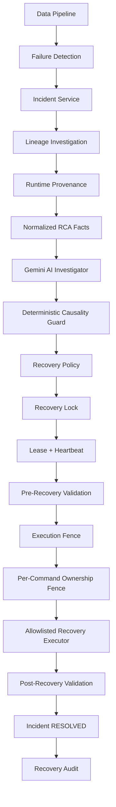

# Phase 3 — Incident Detection, RCA & Automated Recovery

**Project:** Lineage-Aware Autonomous Data Pipeline Incident Detection & Recovery Platform
**Phase Status:** COMPLETE
**Frozen:** November 14, 2026

---

## 1. Phase 3 Goal

Phase 3 adds an automated incident-management and recovery layer to the data platform.

## 2. High-Level Architecture



## 3. Phase 3 Components

### 3A — Lineage-Aware RCA and Blast Radius

The incident service uses lineage information to determine which datasets and downstream components may be affected by a failure.

Primary lineage components:

- OpenLineage
- Marquez
- Neo4j
- Dataset metadata
- Incident metadata

The purpose of lineage is to answer:

- Where did the failure occur?
- What upstream datasets may have contributed?
- What downstream datasets may be affected?
- What is the blast radius?

### 3B — Unified Investigation Context

Incident investigation combines multiple evidence sources into a single normalized context.

Evidence may include:

- Incident metadata
- Primary detection signal
- Dataset schema
- Data-quality results
- Lineage metadata
- Upstream/downstream datasets
- Runtime provenance
- Failure-injection provenance
- Diagnostic results

### 3C — AI-Assisted RCA

The AI investigator uses a provider-neutral request contract.

Current real provider:

- Google Gemini
- Model: `gemini-3.5-flash-lite`

Relevant modules:

```text
incident_service/rca/facts.py
incident_service/rca/ai_contract.py
incident_service/rca/ai_investigator.py
incident_service/rca/providers/gemini.py
```

The AI response contains:

- root_cause_hypothesis
- confidence
- supporting_evidence
- contradicting_evidence
- missing_evidence
- recommended_diagnostics
- affected_components

The AI is advisory and cannot independently authorize recovery.

## 4. Deterministic AI Guardrails

### Affected-Component Guardrail

Affected components must match components supported by deterministic investigation context.

The LLM cannot invent arbitrary affected systems.

### Causality Guardrail

A recovery action requires deterministic evidence connecting the incident to the identified cause.

For controlled schema-drift incidents, runtime provenance is treated as authoritative evidence.

## 5. Runtime Provenance

Runtime provenance provides deterministic evidence describing what actually happened during a controlled failure.

For the final Phase 3 regression:

```text
scenario = SCHEMA_DRIFT
execution_id = 87533964-bd6a-4d8a-8253-a6c7da0b9fa5
target_dataset = silver/transactions
injected_column = final_hardening_test_column
injected_value = PHASE_3F_15
status = COMPLETED
```

## 6. Recovery Policy

Recovery policy is implemented in:

```text
incident_service/recovery/policy.py
```

For verified schema drift, the selected action is:

```text
RESTORE_SCHEMA_DRIFT_BACKUP
```

Automatic execution is allowed only when deterministic evidence satisfies the policy.

The policy does not rely on LLM confidence as the authority for automatic recovery.
## 7. Recovery Executor

Recovery execution is implemented in:

```text
incident_service/recovery/executor.py
```

Only allowlisted recovery actions can execute.

For schema drift, the supported action is:

```text
RESTORE_SCHEMA_DRIFT_BACKUP
```

Each external command has a bounded timeout of 180 seconds.

---

## 8. Schema Drift Recovery

The restore script is:

```text
failure_injection/scenarios/restore_schema_drift.py
```

Recovery flow:

```text
Read clean backup
        ↓
Write temporary restored dataset
        ↓
Move restored data to Silver
        ↓
Validate restored schema
```

---

## 9. Recovery Validation

Recovery validation is implemented in:

```text
incident_service/recovery/validator.py
```

Healthy Silver state:

```text
dataset_exists = True
capture_status = CAPTURED
healthy = True
recovery_needed = False
remaining_detections = []
schema_column_count = 15
```

---

## 10. Incident Lifecycle

```text
OPEN
  ↓
INVESTIGATING
  ↓
RECOVERING
  ↓
RESOLVED
```
## 11. Recovery Audit

Recovery attempts are persisted in PostgreSQL table:

```text
recovery_attempts
```

Important fields include:

```text
recovery_attempt_id
incident_id
action
status
automatic_execution_allowed
rca_assessment
recovery_decision
execution_result
validation_result
error_message
started_at
completed_at
heartbeat_at
lease_expires_at
```

This provides a durable audit trail independent of the Python process.

---

## 12. Recovery Concurrency Protection

Only one active recovery attempt is allowed per incident.

The database enforces this with a partial unique index covering:

```text
STARTED
RECOVERING
```

Concurrent recovery workers therefore cannot both own the same incident.

The database is the final concurrency authority.

---

## 13. Lease and Heartbeat

Each active recovery attempt has:

```text
heartbeat_at
lease_expires_at
```

Default recovery lease:

```text
300 seconds
```

Default heartbeat interval:

```text
60 seconds
```

While the recovery worker is alive, the heartbeat extends its lease.

If the worker crashes:

```text
heartbeat stops
      ↓
lease expires
      ↓
attempt becomes LEASE_EXPIRED
      ↓
another worker may acquire recovery ownership
```

Expired attempts cannot continue refreshing their leases.

---

## 14. Execution Fencing

The recovery attempt ID acts as the application-level fencing token.

Before destructive recovery begins, the worker must atomically claim execution ownership.

A worker can claim execution only when:

```text
status = STARTED
AND
lease has not expired
```

Successful claim transitions:

```text
STARTED
   ↓
RECOVERING
```

Expired workers cannot regain execution ownership.

---

## 15. Per-Command Ownership Fencing

Recovery may contain multiple external commands.

Ownership is therefore checked immediately before each external command.

Example:

```text
Guard
 ↓
Command 1
 ↓
Guard
 ↓
Command 2
```

If ownership is lost between commands:

```text
Command 1 may have completed
Command 2 is blocked
```

The executor records:

```text
failure_type = EXECUTION_FENCE_REJECTED
completed_steps = [...]
executed = True
```

when partial execution has already occurred.

This prevents a stale recovery worker from continuing to perform additional side effects after ownership has been lost.

## 16. Crash-Safe Replay Protection

Before destructive recovery executes, the system validates whether
recovery is still required.

Flow:

```text
Recovery attempt acquired
        ↓
RCA
        ↓
Policy
        ↓
Pre-execution validation
        ↓
Is target already healthy?
```

If YES:

```text
Do not execute recovery again
        ↓
SKIPPED_ALREADY_RECOVERED
        ↓
Audit = ALREADY_RECOVERED
        ↓
Incident RESOLVED
```

This protects against replay after an ambiguous process crash where
the previous recovery may already have succeeded.

---

## 17. Structured Failure Auditing

Recovery execution failures are represented using:

```text
RecoveryExecutionError
```

Structured failure evidence can include:

```text
action
status
executed
failure_type
failed_command
returncode
timeout_seconds
completed_steps
logs
```

Failure types include:

```text
COMMAND_FAILED
TIMEOUT
EXECUTION_GUARD_ERROR
EXECUTION_FENCE_REJECTED
```

---

## 18. Bounded Log Capture

External commands can generate very large Spark logs.

The audit system intentionally stores only bounded log tails.

Successful command logs:

```text
maximum captured characters = 4000
```

Failure command logs:

```text
maximum captured characters = 2000
```

Audit metadata also records:

```text
stdout_truncated
stderr_truncated
stdout_char_count
stderr_char_count
```

This prevents unbounded PostgreSQL JSONB growth while preserving
useful debugging evidence.

---

## 19. Recovery Attempt Terminal States

Terminal recovery states include:

```text
COMPLETED
EXECUTION_FAILED
VALIDATION_FAILED
VALIDATION_ERROR
MANUAL_REVIEW
DRY_RUN
RCA_FAILED
POLICY_FAILED
LEASE_EXPIRED
PRECHECK_ERROR
ALREADY_RECOVERED
```

Terminal attempts receive:

```text
completed_at
```

---

## 20. Final Hardened End-to-End Test

The final Phase 3 regression used:

```text
Incident ID: 8
Incident Type: SCHEMA_DRIFT
Severity: HIGH
Injected Column: final_hardening_test_column
Injected Value: PHASE_3F_15
Schema Before Recovery: 16 columns
```

The incident was detected as:

```text
drift_type = UNEXPECTED_COLUMN
column_name = final_hardening_test_column
```

Runtime provenance matched the incident exactly.

Gemini RCA identified the controlled schema-drift provenance as
supporting evidence.

The deterministic policy selected:

```text
RESTORE_SCHEMA_DRIFT_BACKUP
automatic_execution_allowed = True
```

---

## 21. Final Recovery Result

Recovery attempt:

```text
recovery_attempt_id = 25
incident_id = 8
action = RESTORE_SCHEMA_DRIFT_BACKUP
status = COMPLETED
```

Execution:

```text
executed = True
status = COMPLETED
```

Post-recovery validation:

```text
dataset_exists = True
healthy = True
recovery_needed = False
remaining_detections = []
schema_column_count = 15
```

Incident database state:

```text
OPEN
 ↓
RESOLVED
```

Final incident:

```text
incident_id = 8
status = RESOLVED
```

---

## 22. Final Worker Cleanup Verification

After the final recovery, PostgreSQL was checked for active recovery
workers.

Query:

```sql
SELECT
    recovery_attempt_id,
    incident_id,
    action,
    status,
    heartbeat_at,
    lease_expires_at
FROM recovery_attempts
WHERE status IN ('STARTED', 'RECOVERING');
```

Result:

```text
0 rows
```

Therefore:

```text
No abandoned STARTED attempts
No abandoned RECOVERING attempts
No active stale workers
No active recovery lock
```

---

## 23. Phase 3 Completion Status

```text
3A  Lineage-Aware RCA / Blast Radius             COMPLETE
3B  Unified Investigation Context                COMPLETE
3C  AI-Assisted RCA + Guardrails                 COMPLETE
3D  Runtime Provenance + Deterministic RCA       COMPLETE
3E  Automated Recovery                           COMPLETE
3F  Production Hardening                         COMPLETE
```

Production-hardening coverage:

```text
Concurrency control
Lease lifecycle
Heartbeat lifecycle
Stale-worker expiration
Execution fencing
Per-command fencing
Pre-recovery idempotency validation
Replay protection
Allowlisted recovery
Structured failure auditing
Bounded command logs
Post-recovery validation
Persistent audit history
Full hardened E2E regression
```

---

## 24. Final Architecture Principle

The most important architectural rule of Phase 3 is:

> AI may assist with investigation, but deterministic controls decide
> whether infrastructure-changing recovery is permitted.

The final authority chain is:

```text
Observed Evidence
      ↓
Deterministic Facts
      ↓
AI-Assisted Investigation
      ↓
Deterministic Guardrails
      ↓
Deterministic Recovery Policy
      ↓
Database Ownership
      ↓
Lease
      ↓
Execution Fence
      ↓
Allowlisted Recovery
      ↓
Validation
      ↓
RESOLVED
```

---

## 25. Phase 3 Status

**PHASE 3 — COMPLETE**

The platform now supports a complete path from incident detection to
validated automated recovery while maintaining deterministic safety,
concurrency protection, crash recovery, replay protection, and a
durable audit trail.
