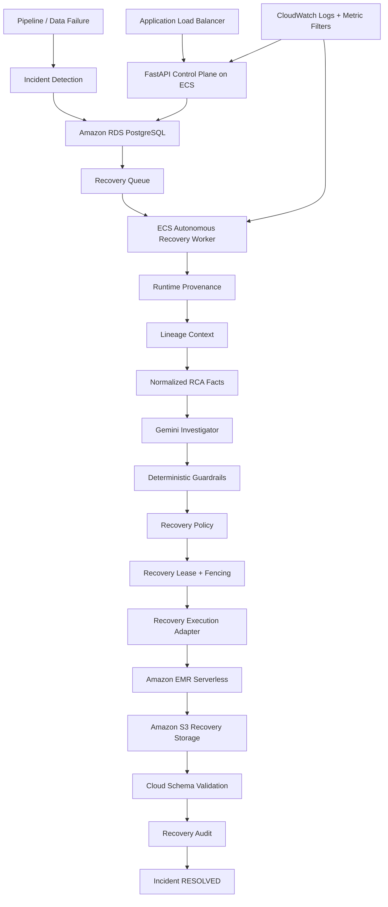

# Phase 5 — AWS Cloud Production Deployment

**Project:** Lineage-Aware Autonomous Data Pipeline Incident Detection & Recovery Platform

**Phase:** 5 — AWS / Cloud Production Deployment

**Status:** Phase 5A–5F COMPLETE

**Current Phase:** 5G — Final Architecture / Documentation

---

## 1. Purpose

Phase 5 moves the hardened autonomous recovery platform from a local-only execution model into a reproducible AWS deployment while preserving the existing recovery safety model.

The cloud implementation does not replace the Phase 3 recovery engine or Phase 4 autonomous platform.

Instead, it provides managed AWS infrastructure for:

- recovery execution
- recovery storage
- control-plane hosting
- autonomous worker hosting
- PostgreSQL persistence
- infrastructure provisioning
- CI validation
- operational CloudWatch visibility

The core authority model remains unchanged:

```text
Observed Evidence
↓
Runtime Provenance
↓
Lineage Context
↓
Normalized RCA Facts
↓
AI-Assisted Investigation
↓
Deterministic Guardrails
↓
Deterministic Recovery Policy
↓
Database Ownership
↓
Lease + Fencing
↓
Allowlisted Recovery Execution
↓
Post-Recovery Validation
↓
Incident Resolution
```

AI remains advisory.

Deterministic controls remain authoritative.

---

## 2. Phase 5 Status

```text
Phase 5A — Execution Adapter Abstraction        COMPLETE
Phase 5B — AWS Cloud Recovery Execution         COMPLETE
Phase 5C — AWS Infrastructure as Code           COMPLETE
Phase 5D — Cloud Control Plane Deployment       COMPLETE
Phase 5E — Terraform CI/CD Checks               COMPLETE
Phase 5F — AWS Observability Hardening          COMPLETE
Phase 5G — Final Architecture / Documentation   COMPLETE
```

---

## 3. Final AWS Architecture



---

## 4. AWS Infrastructure

The deployed AWS environment contains:

```text
Amazon VPC
2 public subnets
Application Load Balancer
Amazon ECS / AWS Fargate
FastAPI control-plane service
Autonomous recovery-worker service
Migration task
Amazon RDS PostgreSQL 16
Amazon ECR
Amazon S3
Amazon EMR Serverless
AWS IAM
AWS Secrets Manager
Amazon CloudWatch Logs
CloudWatch log metric filters
```

Region:

```text
us-east-1
```

---

## 5. Network Architecture

```text
Internet / Operator
↓
Application Load Balancer
↓
ECS FastAPI Service
↓
Amazon RDS PostgreSQL
```

RDS is not exposed as a public application endpoint.

The ALB target group performs readiness checks against:

```text
/ready
```

---

## 6. Container Deployment

Separate workloads are deployed for:

```text
FastAPI control plane
Autonomous recovery worker
Database migration task
```

Amazon ECR stores the application images.

The recovery worker processes the durable recovery queue and delegates execution to the existing hardened recovery orchestrator.

---

## 7. Cloud Control Plane

The FastAPI control plane runs on ECS/Fargate behind the Application Load Balancer.

Operational endpoints include:

```text
/health
/ready
/incidents
/incidents/{incident_id}
/incidents/{incident_id}/recovery-attempts
/incidents/{incident_id}/recovery-queue
/incidents/{incident_id}/requeue
/metrics/summary
/metrics
/dashboard
```

The API does not bypass deterministic policy, provenance validation, queue ownership, recovery leases, fencing, replay protection, or post-recovery validation.

---

## 8. Cloud Recovery Execution

Supported execution backends:

```text
local-docker
emr-serverless
```

Supported storage backends:

```text
minio
aws-s3
```

AWS runtime:

```text
RECOVERY_EXECUTION_BACKEND=emr-serverless
RECOVERY_STORAGE_BACKEND=aws-s3
```

Recovery Spark workloads run through Amazon EMR Serverless.

Recovery data and artifacts are stored in Amazon S3.

---

## 9. Cloud Runtime Provenance

The RCA layer correlates:

```text
Incident
+
Observed Schema
+
Runtime Provenance
+
Lineage Evidence
```

before producing normalized RCA facts.

Missing optional local Neo4j configuration does not invalidate deterministic cloud runtime provenance.

Unexpected RCA failures continue to fail closed.

---

## 10. AWS Recovery Validation

Recovery is not considered successful merely because an EMR job succeeds.

The validator requires:

```text
dataset_exists = True
capture_status = CAPTURED
healthy = True
recovery_needed = False
remaining_detections = []
schema_column_count = 15
```

Only then may the incident transition to:

```text
RESOLVED
```

---

## 11. Real Autonomous Cloud E2E Proof

Final successful cloud recovery:

```text
Incident ID:                 1
Incident Type:               SCHEMA_DRIFT
Recovery Attempt:            4
Recovery Action:             RESTORE_SCHEMA_DRIFT_BACKUP
Automatic Execution:         true
Execution Backend:           emr-serverless
Storage Backend:             aws-s3
Recovery Status:             COMPLETED
Post-Validation Healthy:     true
Recovery Needed:             false
Final Schema Columns:        15
Remaining Detections:        none
Final Incident Status:       RESOLVED
```

Recovery EMR job:

```text
00gadjh5i3f6u00b
```

Post-validation schema-capture job:

```text
00gadjimkab5d80b
```

Final queue state:

```text
COMPLETED
```

Validated cloud path:

```text
Schema Drift
↓
Incident
↓
Durable Recovery Queue
↓
ECS Autonomous Worker
↓
Cloud Runtime Provenance
↓
Gemini RCA
↓
Deterministic Recovery Policy
↓
Recovery Lease + Fencing
↓
EMR Serverless Recovery
↓
S3 Dataset
↓
EMR Serverless Validation
↓
Recovery Audit
↓
Queue COMPLETED
↓
Incident RESOLVED
```

---

## 12. Terraform Architecture

Application infrastructure:

```text
infrastructure/terraform/aws/
```

Bootstrap infrastructure:

```text
infrastructure/terraform/bootstrap/
```

Normal application Terraform identity flow:

```text
IncidentRecoveryBootstrap
        ↓
sts:AssumeRole
        ↓
IncidentRecoveryProvisioner
        ↓
Application AWS Infrastructure
```

Bootstrap maintenance is break-glass/admin-only.

Root credentials are not used for normal application Terraform operations.

---

## 13. Terraform Remote State

Application state:

```text
phase5c/terraform.tfstate
```

Bootstrap state:

```text
bootstrap/terraform.tfstate
```

Backend protections include:

```text
S3 versioning
server-side encryption
public-access protection
native S3 lockfile locking
```

---

## 14. Terraform CI Validation

GitHub Actions validates both Terraform stacks using:

```text
terraform fmt -check
terraform init -backend=false -lockfile=readonly
terraform validate
```

CI does not automatically perform:

```text
terraform plan
terraform apply
AWS deployment
```

---

## 15. AWS Observability

CloudWatch log groups:

```text
/ecs/ai-data-pipeline-incident-recovery-dev/api
/ecs/ai-data-pipeline-incident-recovery-dev/worker
/ecs/ai-data-pipeline-incident-recovery-dev/migration
```

Retention:

```text
14 days
```

CloudWatch metric namespace:

```text
IncidentRecovery/dev
```

Recovery lifecycle metrics:

```text
RecoveryResolvedCount
RCAFailedCount
PolicyFailedCount
ExecutionFailedCount
ValidationErrorCount
ValidationFailedCount
WorkerErrorCount
ClaimLostCount
```

CloudWatch monitoring complements the existing Phase 4 application-level metrics and dashboard.

---

## 16. Final Safety Model

```text
Explicit automation eligibility
+
Durable queue ownership
+
Queue claim lease
+
Runtime provenance
+
AI-assisted RCA
+
Deterministic RCA guardrails
+
Deterministic recovery policy
+
Recovery-attempt ownership
+
Recovery lease
+
Execution fencing
+
Replay protection
+
Allowlisted execution adapter
+
EMR Serverless execution
+
Mandatory post-recovery validation
+
Immutable recovery audit
+
Operational observability
```

No individual layer is treated as sufficient by itself.

---

## 17. Phase 5A–5F Completion

```text
Execution adapter abstraction        PASS
AWS S3 recovery storage              PASS
AWS EMR Serverless execution         PASS
Cloud schema validation              PASS
Cloud runtime provenance             PASS
Real cloud recovery                  PASS
AWS infrastructure as code           PASS
Remote Terraform state               PASS
IAM bootstrap separation             PASS
ECS/Fargate deployment               PASS
Application Load Balancer            PASS
Amazon RDS PostgreSQL                PASS
Amazon ECR                           PASS
AWS Secrets Manager                  PASS
Autonomous cloud worker              PASS
FastAPI cloud control plane          PASS
Terraform CI validation              PASS
CloudWatch log integration           PASS
CloudWatch recovery metrics          PASS
Real autonomous cloud E2E            PASS
```

---

## 18. Current Project State

```text
Phase 1 — Core Data Pipeline                     COMPLETE
Phase 2 — Data Quality, Metadata & Lineage       COMPLETE
Phase 3 — Incident Detection & Recovery          COMPLETE
Phase 4 — Platformization & Autonomous Ops       COMPLETE
Phase 5A — Execution Adapter Abstraction         COMPLETE
Phase 5B — AWS Cloud Recovery Execution          COMPLETE
Phase 5C — AWS Infrastructure as Code            COMPLETE
Phase 5D — Cloud Control Plane Deployment        COMPLETE
Phase 5E — Terraform CI/CD Checks                COMPLETE
Phase 5F — AWS Observability Hardening           COMPLETE
Phase 5G — Final Architecture / Documentation    COMPLETE
```

---

## 19. Architecture Principle

> AI may assist with investigation, but deterministic controls decide whether infrastructure-changing recovery is permitted.

The transition to AWS changes the execution environment.

It does not change the authority model.
