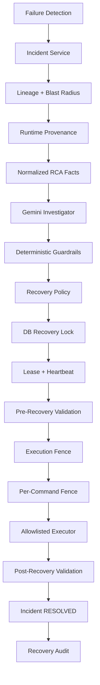

# Automated Recovery Architecture

**Project:** AI-Powered Data Pipeline Incident Detection & Recovery Platform
**Component:** Phase 3 Recovery Architecture
**Status:** COMPLETE
**Frozen:** November 14, 2026

---

## 1. Architecture Overview



---

## 2. Design Objective

The recovery subsystem must repair supported pipeline failures without allowing:

- duplicate recovery workers
- stale recovery workers
- unverified AI actions
- unsupported shell commands
- duplicate recovery replay
- silent recovery failure
- incident resolution without validation

---

## 3. Authority Model

Gemini is advisory. Deterministic controls remain authoritative.

```text
Gemini RCA
   ↓
Deterministic Guardrails
   ↓
Deterministic Recovery Policy
   ↓
Database Ownership
   ↓
Lease + Fencing
   ↓
Allowlisted Recovery
   ↓
Validation
```

The LLM cannot directly execute infrastructure-changing actions.

---

## 4. Recovery Ownership

Recovery ownership is persisted in PostgreSQL.

Only one active recovery attempt may exist per incident.

Active states:

```text
STARTED
RECOVERING
```

A partial unique database index prevents concurrent workers from owning the same incident.

The database is the final concurrency authority.

---

## 5. Lease and Heartbeat

Each active recovery attempt contains:

```text
heartbeat_at
lease_expires_at
```

Defaults:

```text
Lease:     300 seconds
Heartbeat: 60 seconds
```

While a worker is alive, the heartbeat refreshes its lease.

If the worker crashes:

```text
Heartbeat stops
↓
Lease expires
↓
Attempt becomes LEASE_EXPIRED
↓
Another worker may acquire ownership
```

Expired workers cannot refresh their lease.

---

## 6. Execution Fencing

Before destructive recovery begins, the worker must atomically claim execution ownership.

```text
STARTED
↓
claim_recovery_execution()
↓
RECOVERING
```

The claim succeeds only if the lease is still valid.

The `recovery_attempt_id` acts as the application-level fencing token.

A stale worker whose lease has expired cannot regain execution ownership.

---

## 7. Per-Command Fencing

A multi-command recovery revalidates ownership before every external side effect.

```text
Guard
↓
Command 1
↓
Guard
↓
Command 2
```

If ownership is lost between commands:

```text
failure_type = EXECUTION_FENCE_REJECTED
```

and no later command executes.

If one or more commands already completed:

```text
completed_steps > 0
executed = True
```

This preserves accurate partial-execution audit semantics.

---

## 8. Replay Protection

Before destructive recovery, the validator checks whether recovery is still required.

If the target is already healthy:

```text
SKIPPED_ALREADY_RECOVERED
↓
ALREADY_RECOVERED
↓
Incident RESOLVED
```

This handles the ambiguous-crash scenario:

```text
Recovery succeeds
↓
Worker crashes before final audit
↓
Replacement worker starts
↓
Precheck detects healthy target
↓
Recovery is not executed twice
```

---

## 9. Schema Drift Recovery

Supported recovery action:

```text
RESTORE_SCHEMA_DRIFT_BACKUP
```

Storage paths:

```text
Silver:
s3a://data-platform/silver/transactions

Backup:
s3a://data-platform/failure-backups/schema-drift/silver-transactions

Temporary Restore:
s3a://data-platform/failure-temp/schema-drift-restore/silver-transactions
```

Recovery flow:

```text
Clean Backup
↓
Temporary Restore
↓
Replace unhealthy Silver
↓
Capture schema
↓
Validate
```

The recovery command is deterministic and allowlisted.

---

## 10. Validation Contract

Healthy schema-drift recovery requires:

```text
dataset_exists = True
capture_status = CAPTURED
healthy = True
recovery_needed = False
remaining_detections = []
schema_column_count = 15
```

Only after this contract passes may the incident transition to:

```text
RESOLVED
```

---

## 11. Audit Model

Every recovery attempt records:

```text
RCA assessment
Recovery decision
Execution result
Validation result
Failure evidence
Lease information
Start time
Completion time
```

Command logs are bounded to protect PostgreSQL JSONB storage from uncontrolled Spark output.

Successful logs:

```text
MAX_CAPTURED_LOG_CHARS = 4000
```

Failure logs:

```text
MAX_ERROR_LOG_CHARS = 2000
```

---

## 12. Failure Behavior

```text
RCA failure
→ RCA_FAILED

Policy failure
→ POLICY_FAILED

Precheck failure
→ PRECHECK_ERROR

Expired worker
→ LEASE_EXPIRED

Command failure
→ EXECUTION_FAILED

Validation failure
→ VALIDATION_FAILED

Validation infrastructure error
→ VALIDATION_ERROR
```

Structured executor failures may include:

```text
COMMAND_FAILED
TIMEOUT
EXECUTION_GUARD_ERROR
EXECUTION_FENCE_REJECTED
```

---

## 13. Final Phase 3 Proof

Final regression:

```text
Incident ID: 8
Incident Type: SCHEMA_DRIFT
Injected Column: final_hardening_test_column
Recovery Attempt: 25
```

The real execution successfully completed:

```text
Detection
↓
RCA
↓
Runtime provenance verification
↓
Deterministic recovery policy
↓
Concurrency lock
↓
Lease + heartbeat
↓
Precheck
↓
Execution fence
↓
Per-command fencing
↓
Spark restore
↓
Post-recovery validation
↓
RESOLVED
```

Final state:

```text
Incident 8: RESOLVED
Recovery Attempt 25: COMPLETED
Silver columns: 15
healthy: True
recovery_needed: False
remaining_detections: []
active recovery workers: 0
```

---

## 14. Architecture Summary

The recovery subsystem uses defense in depth:

```text
Evidence
+ AI assistance
+ deterministic guardrails
+ deterministic recovery policy
+ database concurrency
+ leases
+ fencing
+ idempotency
+ allowlisting
+ validation
+ durable auditing
```

No individual safety layer is treated as sufficient by itself.

The key architecture principle is:

> AI may assist with investigation, but deterministic controls decide whether infrastructure-changing recovery is permitted.
